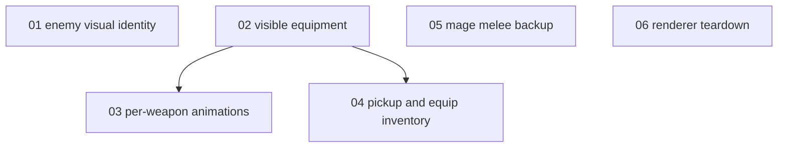

# Lastwatch build-up: the ticket graph

Ticket system for this cluster: Markdown files in this directory,
riding the repo (the workshop `dev/projects/` convention mapped into
the game's own tree). The tickets own the truth. When this file
disagrees with them, regenerate this file.

| # | Ticket | Status |
|---|---|---|
| 01 | Give every Gloam type its own visual identity | ready-for-agent |
| 02 | Render the gear the watch actually wears | ready-for-agent |
| 03 | Animate each weapon like the thing it is | ready-for-agent (blocked) |
| 04 | Loot you can pick up, carry, and wear | ready-for-agent (blocked) |
| 05 | Give the mage a staff strike | ready-for-agent |
| 06 | Tear the old realm down before building the next one | ready-for-agent |

Frontier: 01, 02, 05, 06

Shipped ahead of this graph on `feature/lastwatch-playtest-2`: the
knight partner defending the hold doors (segment admission with a
stand-at-the-door leash, harness-proven from the yard and from the
rampart) and the light-swing rework (sim-stamped heaviness, alternating
level cuts, per-weapon recovery windows, torso lean).

Browser playtests for every ticket need the browser pane displayed,
because hidden pages get no animation frames.
